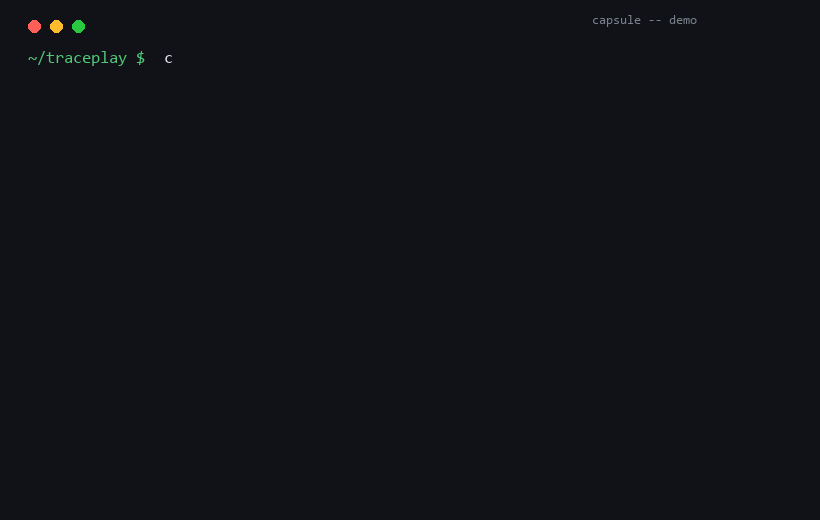

# devcapsule

> **Turn every fixed bug into an answer you can find again.**

devcapsule is a local-first, CLI-powered **developer experience library**. It watches your git workflow, distills each bug fix and feature into a structured *capsule* — **problem → solution → gotcha** — and lets you recall it later with natural language, across all your repos.

Think `git log` × a searchable personal wiki, built automatically while you code.



```text
$ capsule search "如何处理 HTTP 状态码"
[6] 0.55  bugfix  v0.1.0
    The application lacked input validation guards at the CLI entry point, exhibited inconsistent HTTP status codes…
[4] 0.52  bugfix  v0.1.0
    The application was vulnerable to encoding issues like UTF-8 BOMs, lacked strict validation for ports…
```

## Why

You've fixed the same class of bug three times and still re-derived the fix from scratch every time. Nobody writes docs while shipping — so your hard-won experience evaporates.

The wave of "AI devlog" tools (2026) only turns your git history into **narrative diary entries**. devcapsule is different: it produces **structured, searchable lessons** — a retrieval layer over your own experience.

| | devlog tools (commit-story, devlog-cli…) | devcapsule |
|---|---|---|
| Trigger | every commit | **bug-fix / feature events** (classified) |
| Output | narrative diary / report | **structured capsule: 问题·方案·踩坑** |
| Recall | browse the log | **semantic search** ("how did I fix X before") |
| Scope | single repo, single tool | **cross-repo, local-first** |
| Data | markdown files | **SQLite + vectors, yours, offline** |

No other tool occupies that combination today.

## Features

- **Event-level capture** — a `post-commit` hook feeds diffs to a local LLM that classifies *what just happened* (bugfix / feature / chore / refactor) and extracts the capsule. Narrative tools log everything; capsules only save what you'll need later.
- **Structured capsules** — 问题 (problem) · 方案 (solution) · 踩坑 (gotcha), with file/commit references.
- **Semantic recall** — describe the symptom in your own words; get past solutions ranked. Local embeddings by default.
- **Local-first & private** — SQLite + vector index on your machine. Ollama works out of the box; any OpenAI-compatible API supported. No cloud, no telemetry.
- **One-command export** — markdown capsules → weekly report, blog draft, or your own knowledge base.
- **Quality you can measure** — `capsule eval` runs a 50-example labeled set against your model to report classification accuracy (~94-96% with `qwen3:0.6b`).
- **Human-in-the-loop** — review/edit/delete any capsule. The hook proposes; you dispose.

## Install

```bash
pip install devcapsule          # or: uv tool install devcapsule
capsule init                    # installs the git hook, creates ~/.devcapsule/
capsule doctor                  # checks hook + LLM config
```

Requires Python 3.10+. Local LLM via [Ollama] by default, or any OpenAI-compatible endpoint.

**Want to see it work in 60 seconds?** `bash examples/demo.sh` builds a throwaway repo with real bug→fix history and runs the full pipeline. See [`examples/`](examples/README.md).

Configuration (environment variables):

| var | default | meaning |
|---|---|---|
| `DEVCAPSULE_HOME` | `~/.devcapsule` | data directory |
| `DEVCAPSULE_BASE_URL` | `http://localhost:11434` | LLM base URL |
| `DEVCAPSULE_MODEL` | `qwen3:0.6b` | model name (classify + extract) |
| `DEVCAPSULE_EXTRACT_MODEL` | *(same as above)* | larger model for higher-quality extraction |
| `DEVCAPSULE_API_KEY` | *(unset)* | sets API style to OpenAI-compatible |
| `DEVCAPSULE_API_STYLE` | `ollama` | `ollama` or `openai` |
| `DEVCAPSULE_EMBED_MODEL` | `bge-m3:latest` | embedding model for semantic search |

Semantic search uses a three-tier strategy: Ollama embeddings (e.g. `bge-m3:latest`) if reachable → sentence-transformers (`pip install "devcapsule[local]"`) → built-in lexical fallback (always works, less semantic).

Model sizing matters more than you'd think:
- `qwen3:0.6b` (default) — small, cold-starts in ~1s, great for *classifying* commits (bugfix/feature/refactor/…), runs anywhere.
- `qwen3.5:9b` (via `DEVCAPSULE_EXTRACT_MODEL`) — for *extracting* genuine "gotcha" insights. Small models tend to just repeat the commit subject; larger models surface the actual pitfall and the *why*.

Split them if you want both speed and quality: classify with the tiny model, extract with the big one.

## How it works

```
git commit ──► post-commit hook
        └──► diff + commit msg ──► local LLM classifies & extracts
                                 └──► {问题, 方案, 踩坑, refs}  ──► SQLite + embeddings
capsule search "…" ──► semantic recall ──► ranked capsules
capsule export --blog ──► markdown
```

Example capsule (auto-generated, lightly edited):

```markdown
## capsule #128 · bugfix · trading-bot · 2026-08-31
**问题**: SQLite "database is locked" under concurrent writer threads
**方案**: WAL mode + busy_timeout=5000; single-writer pattern via a queue
**踩坑**: naive retry loop without jitter made contention worse;
        use `PRAGMA wal_autocheckpoint` tuning, not more retries
**refs**: 7f3a2c1 (fix), tests/test_wal.py
```

## Real-world usage

Distilled from `traceplay` v0.1.0 (a real OSS AI-agent testing tool, 9 commits, run on 2026-09-02 with `qwen3.5:9b` for extraction):

```text
capsule #6 · bugfix · 8c7c1e0c
  problem:  CLI lacked input validation guards, mishandled HTTP status codes,
            and had fragile gzip decompression in streaming extraction.
  solution: entry-point guard + faithful status codes + robust gzip streaming,
            docs synced to release branch.
  gotcha:   do NOT skip validation at CLI entry — later handlers leave you
            open to malformed-arg injection.

capsule #4 · bugfix · 3d858e37
  problem:  vulnerable to UTF-8 BOM, lacked strict validation for ports/formats,
            CLI errors weren't descriptive enough for production debugging.
  solution: input validation in store + CLI, UTF-8 BOM tolerance, boundary
            tests, Makefile publish gate for release readiness.
  gotcha:   never trust filesystem encoding without explicit checks; always
            validate numeric inputs like ports strictly before binding.

$ capsule search "gzip decompression"
[6] 0.58  bugfix  v0.1.0   CLI ... fragile gzip decompression logic ...
[8] 0.38  bugfix  v0.1.0   traceplay config was incomplete ...
```

Small models (e.g. `qwen3:0.6b`) classify well but tend to just repeat the commit subject in the capsule. Larger models (`qwen3.5:9b` and up) actually surface the pitfall. Split them via `DEVCAPSULE_MODEL` + `DEVCAPSULE_EXTRACT_MODEL`.

## Command reference

| command | purpose |
|---|---|
| `capsule init` | install hook + init store |
| `capsule capture` | capture HEAD commit now |
| `capsule backfill` | capture recent uncaptured commits |
| `capsule list [--repo X]` | browse capsules |
| `capsule show <id>` | view / edit a capsule |
| `capsule search "<query>"` | semantic recall |
| `capsule export --blog / --week` | export markdown |
| `capsule forget <id>` | delete (your data, your call) |
| `capsule config list / get / set / unset` | persistent settings (model, embed_model, base_url, …) |
| `capsule eval [--limit N]` | measure classification accuracy on the 50-example eval set |

## Roadmap (short)

- [x] Project direction validated (competitive scan, 2026-09)
- [x] v0.1: capture pipeline + storage (MVP)
- [x] v0.2: semantic search + eval set
- [x] v0.2.1: split classify/extract models, persistent settings (config)
- [ ] v0.3: export, editing UX, multi-repo
- [ ] v0.4: cross-tool events (Cursor/Claude Code sessions)

## Anti-goals

devcapsule is **not**:

- a changelog / release-notes generator (use existing devlog tools)
- a team documentation platform
- an agent memory store (your agents already have their own)

It answers one question only: **"did I solve something like this before — and how?"**

## License

MIT
